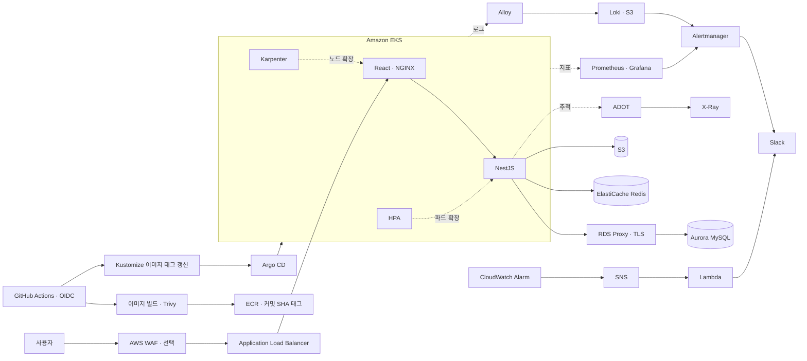

# Food Delivery on Amazon EKS

배달 서비스의 백엔드와 프런트엔드를 Amazon EKS에 배포하고, 인프라 생성부터 배포·모니터링·철거까지 코드로 관리한 프로젝트입니다. Terraform으로 AWS 리소스를 구성하고, GitHub Actions와 Argo CD로 이미지 빌드와 애플리케이션 배포를 연결했습니다.

이 저장소는 포트폴리오 공개용 소스입니다. 실제 계정 ID, 도메인, 인증서, 리소스 ID와 자격 증명은 포함하지 않습니다.

## 아키텍처



## 기술 스택

| 영역 | 구성 |
|---|---|
| 인프라 | Terraform, VPC, EKS, Aurora MySQL, RDS Proxy, ElastiCache, S3 |
| 컨테이너 | Managed Node Group, Karpenter, HPA, Kustomize |
| 배포 | GitHub Actions, OIDC, ECR, Trivy, Argo CD |
| 관측성 | Prometheus, Grafana, Alloy, Loki, ADOT, X-Ray, CloudWatch |
| 보안 | IRSA, Secrets Manager, External Secrets Operator, WAF, NetworkPolicy, CloudTrail |
| 애플리케이션 | NestJS 11, React 19, Vite, NGINX, Node.js 24 |

## 구현에서 다룬 문제

### 빌드한 이미지와 배포한 이미지의 일치

GitHub Actions는 OIDC로 AWS에 인증합니다. 이미지는 소스 커밋 SHA로 태깅하고, Trivy의 HIGH·CRITICAL 검사에서 수정 가능한 취약점이 발견되면 배포를 중단합니다. 검사를 통과한 이미지를 다시 빌드하지 않고 ECR에 올립니다. CI는 dev overlay의 이미지 태그만 갱신하고, Argo CD가 그 변경을 동기화합니다.

계정별 ECR 주소와 IRSA Role, 인증서, 도메인, 네트워크 값은 Terraform 출력과 비공개 설정에서 읽어 Argo CD Application에 주입합니다. 공개 소스에는 템플릿과 예시값을 보관합니다.

### 세션 폐기와 장애 시 인증 처리

로그아웃·토큰 갱신·WebSocket 권한 검사를 세션 상태와 연결했습니다. SQL의 세션 상태를 기준으로 폐기를 판단하고, Redis 장애나 오래된 캐시 때문에 폐기한 토큰이 다시 허용되지 않도록 처리했습니다. HTTP와 WebSocket의 권한 검사, 응답의 민감 필드 제거, 로그·추적 데이터의 비밀값 제거를 테스트합니다.

### 애플리케이션과 AWS 리소스의 관측성 연결

지표는 Prometheus·Grafana, 로그는 Alloy → Loki → S3, 추적은 ADOT → X-Ray로 수집합니다. 클러스터 내부 알람은 Alertmanager를 거쳐 Slack으로, AWS 관리형 리소스의 알람은 CloudWatch → SNS → Lambda를 거쳐 Slack으로 전달합니다.

### 파드 확장과 노드 확장의 역할 분리

HPA는 CPU 사용률을 기준으로 WAS 파드를 확장하고, Karpenter는 파드를 수용할 노드를 공급합니다. 시스템 구성 요소는 관리형 노드 그룹에 배치합니다. Karpenter IAM 정책은 클러스터·NodePool·NodeClass 태그와 대상 리소스로 범위를 제한합니다.

### 배포와 철거의 권한 분리

CI의 이미지 게시 권한과 인프라 운영 권한을 분리했습니다. 철거 스크립트는 계정·리전·클러스터·리소스 소유권을 확인하고, 삭제 계획에 다른 리소스나 삭제 외 작업이 섞이면 중단합니다. 로그 보관 버킷과 잔존 볼륨은 별도 확인 대상으로 다룹니다.

## 검증 범위

기존 dev 환경에서 확인한 결과입니다. 공개본의 로컬 검증은 아래 명령으로 실행할 수 있습니다.

| 항목 | 확인한 내용 |
|---|---|
| CI/CD | OIDC 인증, 이미지 취약점 검사, ECR 게시, Argo CD Synced·Healthy |
| 사용자 인증 | 회원가입 → 이메일 인증 → 로그인 → 갱신 → 로그아웃 후 토큰 차단 |
| 확장 | HPA 2 → 5 → 2, Karpenter 노드 생성·회수 |
| 보안 | WAF Count/Block, 비밀번호 교체 후 새 파드의 DB 연결 |
| 알람 | Alertmanager 발생·해제 메시지, CloudWatch OK 상태 메시지 수신 |
| 철거 | 소유권·삭제 계획을 검증한 dev 환경 철거 |

비밀번호 교체 직후에는 일시적인 DB 연결 실패 구간이 있었습니다. CloudWatch ALARM 상태 메시지는 관측하지 못했습니다. 주문·결제 전체 흐름의 E2E와 prod 환경 운영은 검증 범위에 포함하지 않았습니다.

## 로컬 실행

Node.js 버전은 `.nvmrc`를 따릅니다. Docker Compose와 npm을 사용합니다.

```bash
cd app/coupang_eats_backend_v2
npm ci
cp dotenv/.env.example dotenv/.env.local
```

`.env.local`의 `LOCAL_MYSQL_ROOT_PASSWORD`, `DB_PASSWORD`, `JWT_ACCESS_SECRET`, `JWT_REFRESH_SECRET`를 각각 채웁니다. JWT 키는 서로 다른 난수를 사용합니다. 로컬에서 이메일을 발송하지 않을 경우 `SKIP_EMAIL_NOTIFICATION=true`를 설정합니다.

```bash
npm run docker:up
npm run build
node --env-file=dotenv/.env.local node_modules/typeorm/cli.js migration:run -d dist/src/data-source.js
npm run start:local
```

다른 터미널에서 프런트엔드를 실행합니다.

```bash
cd app/coupang_eats_frontend_v2
npm ci
npm run dev
```

## 검증 명령

```bash
# 저장소 루트: 공개 식별자 검사
python3 scripts/ci/check-public-identifiers.py

# 백엔드: 빌드와 네트워크 프록시·로그 보안 테스트
cd app/coupang_eats_backend_v2
npm run build
npm test -- --runInBand --testPathPatterns='core/(rate-limit|logger)'

# 프런트엔드
cd ../coupang_eats_frontend_v2
npm run build
npm run lint
```

인프라 계약 테스트는 `scripts/test_*.py`, `scripts/test-*.rb`와 각 Terraform 모듈의 `tests/`에 있습니다. 일부 테스트에는 Kustomize·Helm·Terraform provider 초기화가 필요합니다. SQL·Redis 통합 테스트는 별도의 테스트 서비스를 사용합니다. Gitleaks로 공개 커밋 이력의 자격 증명 패턴도 검사합니다.

## AWS 배포 설정

배포 워크플로는 저장소 변수 `ENABLE_AWS_DEPLOYMENT=true`를 설정한 경우에만 실행됩니다.

1. `infra/bootstrap`에서 상태 저장소와 GitHub OIDC 신뢰를 구성합니다. 신뢰 대상은 이 저장소의 owner/repository와 배포 브랜치로 제한합니다.
2. `infra/environments/dev`의 `backend.hcl.example`, `terraform.tfvars.example`과 `config/r2-dev-target.example.json`을 복사해 비공개 입력을 준비합니다. prod 예시는 별도로 제공합니다.
3. GitHub Secret `AWS_ACCOUNT_ID`를 설정합니다. Slack 알림을 사용할 경우 `SLACK_WEBHOOK_URL`을 추가합니다. 식별자 검사에 사용할 비공개 값은 `PUBLIC_IDENTIFIER_DENYLIST`로 지정할 수 있습니다.
4. Terraform 출력과 비공개 대상 설정으로 Application을 렌더링하고, 배포 전 점검 후 동기화합니다.

```bash
python3 scripts/render-argocd-application.py \
  --environment dev \
  --outputs .generated/terraform-outputs.json \
  --target config/r2-dev-target.json \
  --output .generated/argocd-dev.yaml
```

`.generated/`는 Git에서 제외됩니다. 실제 `.env`, `terraform.tfvars`, backend 설정, Terraform state·plan, kubeconfig와 키 파일도 커밋 대상에서 제외합니다. 예시값으로 바로 AWS 배포를 실행할 수는 없습니다.

## 폴더 구조

```text
app/        NestJS 백엔드와 React 프런트엔드
infra/      bootstrap, dev·prod 환경, Terraform 모듈
k8s/        Kustomize base와 환경별 overlay
scripts/    배포 렌더링, 점검, 철거, 회귀 테스트
config/     비공개 배포 설정의 예시
.github/    검증·공개 정보 검사·배포 워크플로
```
